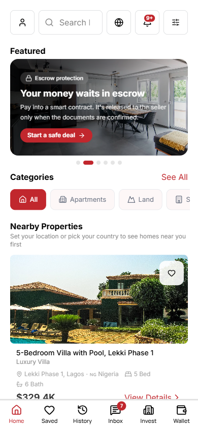

# Welcome to Sheda Solutions

## Revolutionizing real estate operations

Sheda Solutions is a decentralised market where people rent, buy, sell, build and invest in property directly with each other. Money waits in escrow until the deal is done, and every record is on the blockchain.

Nobody on Sheda Solutions runs the deals for you. Builders, investors, property managers, landlords, buyers and renters each run their own part of a property's life. Sheda Solutions provides the rails: escrow, open records and the tools.

### Affable. Available. Affordable. Secure.

* **Affable**: simple enough for anyone. If you can use WhatsApp, you can use Sheda.
* **Available**: open it in any browser, on any device, at any hour. Your deals and documents go where you go.
* **Affordable**: no agent commission on top of the price, and you can invest in property for a fraction of the cost.
* **Secure**: every payment waits in escrow, and every ownership record lives on the blockchain where no one can quietly change it.

### Where to start

| I want to...                     | Read                                                          |
| -------------------------------- | ------------------------------------------------------------- |
| Understand the whole idea        | [The litepaper](litepaper/the-problem.md)                     |
| Rent or buy a home               | [Buying and renting](guides/buying-and-renting.md)            |
| List a property                  | [Selling and letting](guides/selling-and-letting.md)          |
| Own shares in a building         | [Investing in Sheda Collections](guides/investing.md)         |
| Raise money to build             | [For builders](guides/builders.md)                            |
| Manage buildings for their owners | [For property managers](guides/property-managers.md)         |
| Know what it costs               | [Fees](guides/fees.md)                                        |


**Early access.** Sheda Solutions runs in your browser today at [market.sheda.app](https://market.sheda.app), on the NEAR test network, so you can try every feature without real money. Real payments start at mainnet launch, after an independent security audit of the contracts.


<figure><figcaption>
The Sheda Solutions app
</figcaption></figure>
