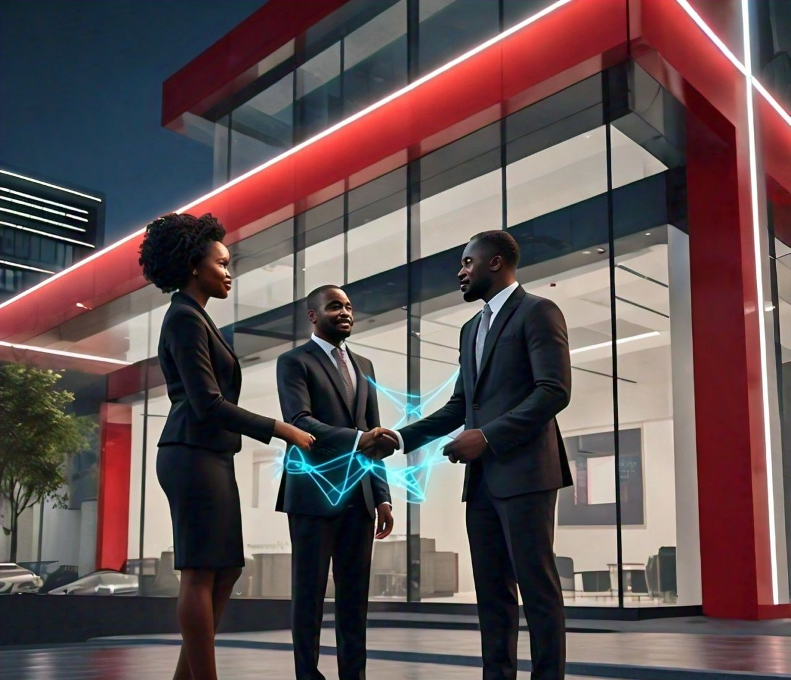
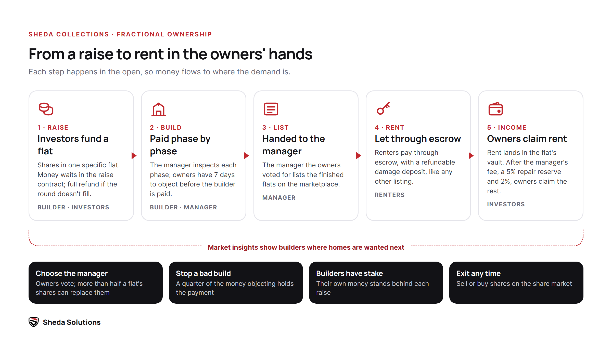

# A decentralised market

## Every role, acting independently

Sheda Solutions is not a broker or an agency. Each participant runs their own part of a property's life, under the same open rules, on one shared record.

| Participant               | What they do                                                                                                            | What protects the other side                                                                          |
| ------------------------- | ----------------------------------------------------------------------------------------------------------------------- | ----------------------------------------------------------------------------------------------------- |
| **Landlords and sellers** | List homes and land, set appointment days and hours, accept offers, send agreements, get paid.                          | The buyer's money is in escrow before the seller does anything; ownership is on record.              |
| **Renters and buyers**    | Search, pay into escrow with Buy now, Rent now or Make an offer, book an appointment to inspect, accept the agreement. | Nothing is released until the buyer accepts the agreement; full refunds before that.                 |
| **Builders**              | Register, post stake, publish a project pack, open a raise, deliver phase by phase.                                     | Paid only after inspection and the objection window; stake covers investors if the build stops.     |
| **Investors**             | Buy shares in a specific flat, vote for the manager, object to bad phases, claim rent, trade shares.                    | Money waits in the raise contract; full refund if the round fails; rent split by contract.           |
| **Property managers**     | Accept a nomination with a fee and a pledge, inspect each phase, take the handover, let the flats.                      | Chosen and replaceable by owners; their fee is capped and visible; their record is public.           |

<figure><figcaption>
Deal directly, on one shared record
</figcaption></figure>

## The property cycle

The roles connect into one cycle. Each turn of it happens in the open, so money flows to where people actually need homes.

<figure><figcaption>
From a raise to rent in the owners' hands
</figcaption></figure>

1. **Raise.** A builder opens a raise for a building. Investors buy shares in specific flats; the money waits in the raise contract.
2. **Build.** The builder is paid one phase at a time, after the chosen manager inspects the phase and owners have had 7 days to object.
3. **List.** The finished flats are handed to the manager, and each flat's vault becomes its landlord on the marketplace.
4. **Rent or sell.** Renters deal through escrow, exactly as with any other listing.
5. **Income.** Rent arrives in the flat's vault and is split among its owners, who claim it directly.

Because the whole cycle is recorded, the market itself shows where homes are wanted: which areas rent fastest, at what prices, and for which types of home. That record feeds **market insights for builders**, so the next raise goes where the demand is, such as student housing near a growing campus or flats in a fast-growing part of a city.

## Benefits of a peer-to-peer market

* **Lower costs.** No agent commission on top of the price; a 2% fee only when a deal completes; no network fees.
* **Transparency.** Every payment, inspection and agreement is on the blockchain, visible to the parties involved.
* **Speed.** Deals move as soon as each side acts, without waiting on third-party approvals.
* **Access.** Anyone can invest in property from a small amount, and anyone can verify who they're dealing with.
* **Control.** Sellers choose their offers; investors choose their manager and can stop a build.

## What "decentralised" means in practice

* **Custody.** Payments wait in smart contracts with fixed, public rules, not in a company bank account.
* **Records.** Ownership, deals and agreement fingerprints are on the NEAR blockchain, where anyone can check them.
* **Keys.** Each user's wallet lives on their own device, not on Sheda's servers.
* **Governance.** Admin actions such as settling disputes or changing a contract need several council members to sign. No single key controls the money.
