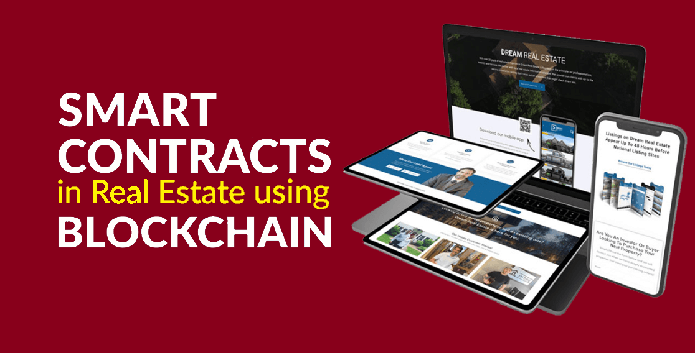
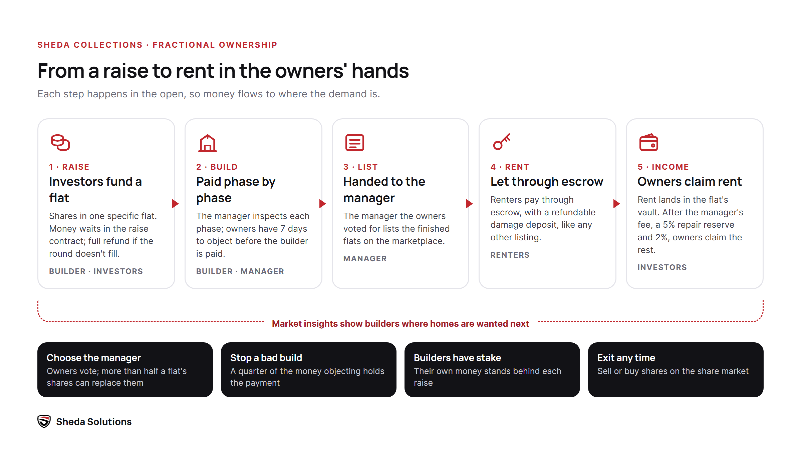

# Product features

<figure><figcaption></figcaption></figure>

## The marketplace

| Feature                         | What it does                                                                                                                                                               |
| ------------------------------- | -------------------------------------------------------------------------------------------------------------------------------------------------------------------------- |
| **Listings on record**          | Homes and land listed with photos, price and details, minted on the blockchain under the owner's account. Owners can edit a listing at any time.                          |
| **Search and discovery**        | Search by location, budget and type, from studio flats to land, with prices in 24 currencies.                                                                             |
| **Buy now / Rent now**          | Pay the listed price straight into escrow.                                                                                                                                 |
| **Make an offer**               | Offer a different price, held in escrow; it expires after 7 days if not accepted.                                                                                         |
| **Appointment requests**        | Sellers set appointment days and one time range, with different hours on any day, in 30-minute steps. Buyers request a time; the seller approves or suggests another. Nothing is ever held or shown as booked. |
| **Agreements and documents**    | The seller sends the agreement and documents to the deal; each document can have several pages, images or a PDF. The buyer accepts, asks for changes, or cancels.        |
| **Refundable damage deposits**  | Held in escrow for the whole lease, never paid to the landlord, and returned automatically if not claimed within 7 days of the lease ending.                              |
| **Leases and renewals**         | Lease terms are recorded on chain; renters can ask to renew and landlords accept in the app.                                                                              |
| **Chat per property**           | One conversation per property between buyer and seller. Agents and businesses can reply as themselves or as their business.                                               |
| **Deal tracking**               | Activities and History show every deal, the step it's on and who must act next, with notifications at each step.                                                         |
| **Promoted placements**         | Owners and builders can pay to feature a listing or raise in the app's promoted banner.                                                                                   |

## Sheda Collections

<figure><figcaption>
Sheda Collections: from a raise to rent in the owners' hands
</figcaption></figure>

| Feature                    | What it does                                                                                                                                       |
| -------------------------- | -------------------------------------------------------------------------------------------------------------------------------------------------- |
| **Builder registration**   | Builders register their company and add licences and registration documents to their profile.                                                     |
| **Project pack**           | Every raise publishes the title documents, approvals, costs, timeline and all agreements; its fingerprint is recorded on chain when the raise opens. |
| **Raises per flat**        | Investors choose a specific flat and an amount above the minimum; money waits in the raise contract.                                               |
| **Manager nominations**    | The builder nominates one to three managers near the project; each accepts with a fee and a written pledge investors can hold them to.             |
| **Manager vote**           | Investors vote with their money; the winner is fixed at close. Owners of more than half a flat's shares can replace the manager later.            |
| **Phase payments**         | Builders are paid phase by phase after the manager's inspection and a 7-day objection window.                                                      |
| **Builder stake**          | Builders post stake that covers investors if a build stops; the cover each raise carries is shown before anyone invests.                           |
| **Ranks**                  | Builders and managers are ranked from their on-chain record, computed in the open.                                                                 |
| **Flat lifecycle**         | Owners follow each flat from funding to building, handover, listing and renting, with notifications at every stage.                               |
| **Rent claims**            | Each flat's rent lands in its vault; owners claim their share whenever it's ready.                                                                 |
| **Share market**           | Owners sell and buy shares between themselves in one atomic transaction.                                                                           |
| **Repair reserve**         | 5% of each flat's rent is kept for repairs; every draw is recorded with a reason.                                                                  |

## Wallet and account

| Feature                 | What it does                                                                                   |
| ----------------------- | ---------------------------------------------------------------------------------------------- |
| **Built-in wallet**     | Created at sign-up, kept on the user's device; nothing to install.                             |
| **One-tap backup**      | Encrypted backup to Google, or a 12-word recovery phrase.                                      |
| **No network fees**     | Sheda Solutions sponsors the network fees on its own contracts.                                |
| **Account security**    | Emailed codes for new devices and every sensitive change; optional transaction PIN.            |
| **Identity checks**     | Optional verification with official ID and a verified badge.                                   |
| **Help Center**         | Plain-language guides to every rule, in the app.                                               |

<figure><figcaption>
If you can use WhatsApp, you can use Sheda
</figcaption></figure>

Sheda Solutions brings the security of smart contracts to everyday property deals without asking anyone to understand the blockchain underneath. The result is a market that is cheaper than working through agents, safer than paying in cash, and open to anyone with a phone.
