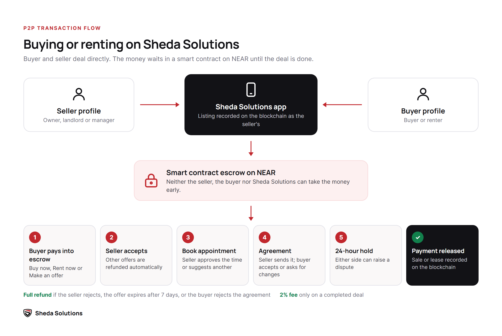

# Technical implementation with blockchain

Sheda Solutions is a decentralized real estate market for landlords, tenants, builders and investors to buy, rent, build or manage properties on secure blockchain infrastructure. Built on the NEAR blockchain.

**Blockchain of choice – NEAR Protocol**

Why NEAR Protocol:

* Scalability: NEAR's sharding technology supports high transaction volumes, essential for a real estate platform where transactions vary widely in size and frequency.
* Ease of Use: Readable account names and a developer-friendly environment allow quick integration of smart contract functionality into our platform.
* Cost Efficiency: Very low network fees make small real estate transactions, like monthly rent or a single share, viable.

Core Technology\
Smart Contracts on NEAR: hold every payment in escrow and keep the records of ownership, deals, raises and rent, under rules anyone can check.

\
Built-in Wallet: each user gets a NEAR wallet at sign-up, kept on their own device, backed up to Google with an encrypted copy or with a 12-word recovery phrase.

\
Gasless Transactions: Sheda Solutions covers the network fees for actions on its own contracts, so users don't need to hold any crypto.

\
Chain Abstraction Layer and Chain Signatures (planned): simplify multi-blockchain interactions and secure cross-chain transactions, so assets and payments can come from other blockchains.

\
Functionality Overview

<figure><figcaption>
P2P transaction flow
</figcaption></figure>

\
: Participants: Sellers (landlords/owners), buyers (tenants/buyers), builders, investors and property managers.\
Transaction Steps:\
-Seller lists the property, recorded on the blockchain as theirs.\
-Buyer chooses Buy now / Rent now, or makes an offer; the money is held in escrow.\
-Seller accepts the offer; every other offer is refunded automatically.\
-Buyer books an appointment to inspect; the seller approves it or suggests another time.\
-Seller sends the agreement and documents; the buyer accepts.\
-Payment is released to the seller after a 24-hour hold, and the sale or lease is finalized on the blockchain.

\
— Architecture

<figure><figcaption>
Technical architecture
</figcaption></figure>

-Marketplace Contract: property records, offers, escrow, agreements, leases, refundable damage deposits and disputes.\
-Raise Contract: each Sheda Collections round, its shares, manager votes and phase-by-phase payments.\
-Flat Vaults: one per flat, opened automatically when a raise fills; receives the flat's rent and pays each owner their share.\
-Stake Registry: builders' stake, and the cover set aside for each raise.\
-Share Market: owners selling and buying shares between themselves.\
-Council: a multi-signature account that settles disputes and controls contract changes.\
-Off-chain services: listings search, chat, notifications and appointments; documents stored off-chain with a fingerprint of each recorded on the blockchain.

\
— Key Features\
-Escrow on Every Deal: no seller, buyer or Sheda Solutions can take the money early.\
-Decentralized Identity: wallet-based accounts and identity checks with official ID reduce fraud.\
-Time-Bound Leases: smart contracts enforce lease terms with expiration/renewal logic.\
-Utilities for Fractional Assets: fractional ownership, rental income distribution, share trading.\
-Dollar Stablecoins: payments in USDC and USDT, with prices shown in 24 currencies.

\
— Security and Scalability\
Security: Escrow, council sign-off for changes, decentralized identity, and an independent smart contract audit before real money moves.\
Scalability: NEAR's sharding design handles high transaction volumes.

This is to deliver a secure, efficient, user-centric real estate transaction platform.
