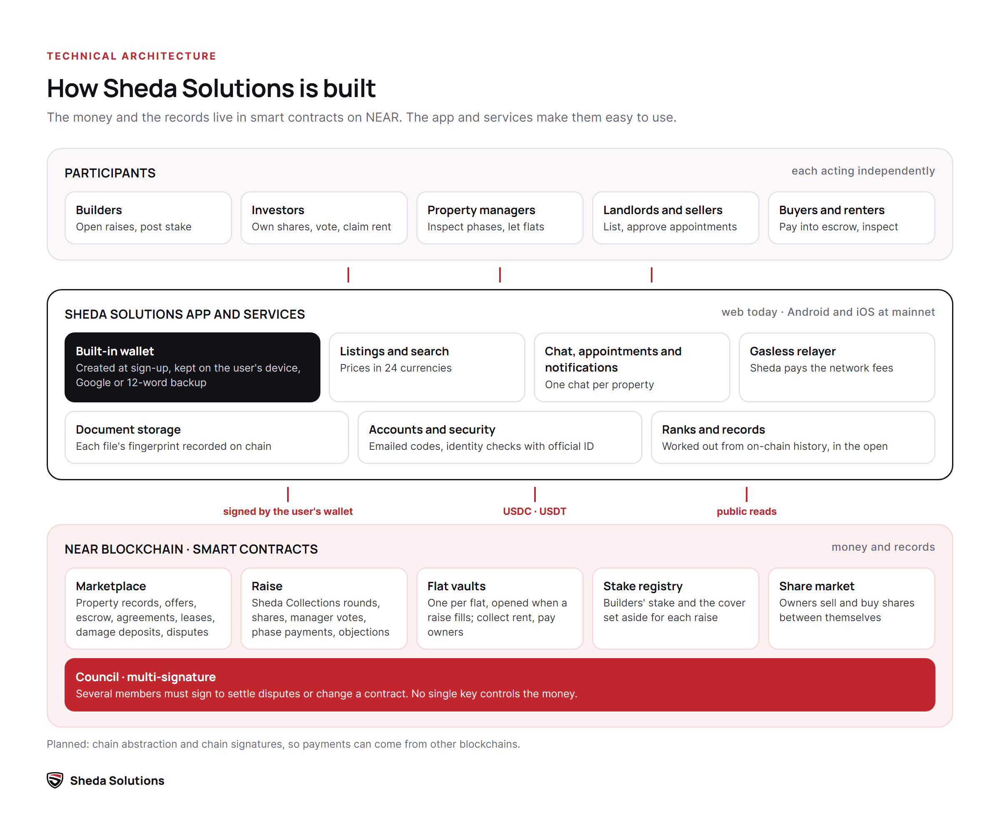

# Technical architecture

## Design principle

One rule decides where every piece of Sheda Solutions lives:

> **Anything that decides who owns what, or who is owed what, lives on the blockchain. Nothing that decides who owns what is stored anywhere else.**

Money, ownership, shares, votes, phase payments, stake and rent are held and computed by smart contracts on NEAR. Everything a contract is the wrong place for (photographs, descriptions, chat, notifications, search) lives in off-chain services that can be rebuilt from the chain at any time. The services never hold a balance, a share count or a score.

<figure><figcaption><p>Technical architecture</p></figcaption></figure>

## Blockchain of choice: NEAR Protocol

| Requirement              | Why NEAR fits                                                                                                                                 |
| ------------------------ | --------------------------------------------------------------------------------------------------------------------------------------------- |
| **Low, predictable cost** | Network fees are a fraction of a cent, which makes monthly rent, a single share or a small refund economical to settle on chain.             |
| **Fast finality**        | Transactions finalise in about two seconds, so a payment into escrow feels like any other app payment.                                         |
| **Scalability**          | NEAR's sharded design (Nightshade) spreads load across shards as usage grows.                                                                  |
| **Human-readable accounts** | Accounts have names, not long hashes, which reduces mistakes and lets each contract and vault have a recognisable address.                  |
| **Account abstraction**  | Native support for meta-transactions (NEP-366) lets Sheda Solutions sponsor network fees, so users never need to hold NEAR.                    |
| **Mature standards**     | NEP-171 (non-fungible tokens) for property records and NEP-141 (fungible tokens) for stablecoins and shares.                                   |

## The smart contracts

Each contract is deployed to its own account and does one job.

### Marketplace contract

The marketplace holds the property records and every marketplace deal.

* **Property records.** Each listing is minted as a non-fungible token (NEP-171) owned by the seller's account. The record carries the property's details and the fingerprints of its documents. Because one token has one owner, a property can't be sold twice.
* **Offers and escrow.** A buyer pays with `ft_transfer_call` on the stablecoin; the payment is held by the contract as a bid against the property. Buy now and Rent now are bids at the listed price.
* **Acceptance.** When the seller accepts one bid, every competing bid is refunded automatically.
* **Agreements.** The seller releases the agreement and documents to the deal. The buyer accepts, asks for changes (the seller redrafts), or rejects and cancels for a full refund.
* **Time lock.** Once the buyer accepts, the payment is held for a **24-hour** safety window. After it, anyone may trigger the release, and the money can only go to the property's owner, so a seller never depends on a server to be paid.
* **Leases.** Rentals record a lease term with expiry and renewal. The refundable damage deposit stays in escrow for the whole lease; the landlord has **7 days** after the lease ends to claim against it, after which the renter can take it back.
* **Expiry.** An offer not accepted within **7 days** expires, and the buyer reclaims it.
* **Disputes.** Either side can freeze a deal between acceptance and release. The money stays put until the council rules; the contract then pays out exactly as ruled.
* **Fee.** The platform fee (200 basis points, 2%) is deducted from the seller's payout on completion and sent to the treasury. Refunds carry no fee.

### Raise contract (Sheda Collections)

The raise contract runs each Sheda Collections round from first commitment to last phase payment.

* **Commitments.** Investors commit stablecoins against a specific flat. The money is held by the raise contract, a separate account from any vault, so a share purchase can never be mistaken for rent.
* **Manager vote.** Each commitment carries a vote for one of the nominated managers, weighted by money. The winner is fixed when the round closes.
* **Withdrawals.** Investors may withdraw while the round fills, except in its final **7 days** or once it's full.
* **Close.** Anyone can close a round once it is full or its deadline passes. A failed round refunds every investor in full; a funded round takes the 2% fee and starts the phase schedule.
* **Automatic vaults.** On a funded close, the raise creates a vault account for each flat from a single published vault code (a global contract, identified by its code hash), initialises it with the round's own terms and registers it with the stablecoin. No one has to deploy anything by hand, and a vault can only exist at its expected address.
* **Phases.** For each phase: the builder calls `request_inspection`, the manager calls `attest` after inspecting in person (a builder can never attest their own work), and then holders have a **7-day** objection window. If objections reach **25% of the money** in the raise, the phase freezes and the build stops. Otherwise the phase's share of the escrow is released to the builder.
* **Self-managed builds.** If the builder's own company is the manager, each phase payment instead needs approval from more than half of the money in the raise.
* **Stopped builds.** On a freeze, each investor independently calls `reclaim` for their share of the unpaid escrow, and `opt_out` for their share of the builder's stake set aside as cover.

### Flat vaults

A vault is a contract that owns one flat on behalf of many people.

* **The vault is the landlord.** The marketplace only knows that a property token has an owner account. A vault is an account, so it holds the flat's token and is the landlord. The marketplace needs no change for a flat owned by three hundred people to be let exactly like a flat owned by one.
* **Fungible shares.** Shares are a NEP-141 token: ten people splitting a flat own identical, divisible claims, not ten different things.
* **Supply is frozen at close.** No mint path survives the close of the raise, so owners can never be diluted.
* **Rent without loops.** Paying every holder in a loop stops working past a few dozen holders because of gas limits. Instead the vault keeps one accumulator:

```
on income:  acc_per_share += income × 10^18 ÷ total_shares
a holder:   owed = balance × acc_per_share ÷ 10^18 − already_credited
on claim:   pay owed; already_credited = balance × acc_per_share ÷ 10^18
```

Crediting rent costs the same for ten holders or ten thousand. Holders pull their rent with `claim()`. Before any share transfer, both sides are settled against the accumulator, so a buyer of shares on Monday never collects rent that accrued in March. Division remainders are carried forward, so repeated small payments lose nothing.

* **Permissionless income sync.** Rent arrives as a plain token transfer. `sync_income()` reads the vault's balance, compares it to a snapshot taken at the start of the call, and credits the difference. Anyone can call it, so a manager who stops acting can't freeze owners out of their rent.
* **Fees with a ceiling.** The manager's fee, a 5% repair reserve and the 2% platform fee are split off on income. The contract refuses any configuration where fees exceed **30%** of rent.
* **Manager actions.** The manager lists the flat, accepts or rejects renters, releases lease documents and draws on the repair reserve, with each draw recorded and a reason given. Owners of more than half a flat's shares can replace the manager; earned fees are never cancelled.
* **Redemption.** A flat can only be taken out of the vault with **every** share, and never while it is let, so a tenant's lease and deposit are never left against an empty vault.

### Stake registry

Stake belongs to a builder's or manager's profile, not to a single deal.

* A profile's balance is **total**, **allocated** and **free**. A raise can only advertise cover that the free balance supports, so the same stake can never be promised to two raises.
* Each allocation is ring-fenced to its own project: if one build stops, only that project's cover can be slashed, never the cover protecting investors in another project.
* Cover is reported by the contract in basis points of the raise target, so the figure on a project card is the figure the chain would actually pay.
* The registry's only controller is the raise contract. Free stake can be withdrawn at any time; allocated stake is locked until its raise ends.

### Share market

Owners sell and buy shares between themselves. Sell listings and buy bids settle as an atomic swap (shares for stablecoins in one transaction), with the 2% fee taken from the sale. Shares settle against the vault's rent accumulator on every trade, so rent always goes to whoever held the shares when it arrived.

### Council

Every contract is owned by a council: a multi-signature account where a set number of members (for example two of three) must confirm any admin action, such as ruling on a dispute, binding a flat to its vault or changing a contract. No single person's key can move user money.

## How a marketplace deal executes

<figure><figcaption><p>P2P transaction flow</p></figcaption></figure>

| Step                 | Who            | On chain                                                                    | Money                                   |
| -------------------- | -------------- | --------------------------------------------------------------------------- | --------------------------------------- |
| 1. List              | Seller         | Property token minted to the seller's account                               | None                                    |
| 2. Secure it         | Buyer          | `ft_transfer_call` creates a bid at the listed or offered price              | Locked in escrow                        |
| 3. Accept            | Seller         | One bid accepted; all others refunded                                       | Others returned in full                 |
| 4. Book appointment  | Buyer, seller  | Off chain: request, approve, or decline with a suggested time               | Still in escrow                         |
| 5. Agreement         | Seller → buyer | Agreement and documents released; fingerprints recorded                      | Still in escrow                         |
| 6. Accept agreement  | Buyer          | Deal agreed; 24-hour time lock starts                                       | Still in escrow                         |
| 7. Release           | Anyone         | After the hold, payout to the owner less 2%; token or lease recorded        | Paid to the seller                      |

At any point before step 6 the buyer can walk away with a full refund; between steps 3 and 7 either side can raise a dispute.

## The app and services

### Built-in wallet

* A NEAR account is created for every user at sign-up. The private key is generated and kept on the user's own device; Sheda's servers never hold it.
* **Backups.** An encrypted copy saved to the user's Google account, sealed with a backup password only they know, or a standard 12-word recovery phrase.
* **Protection.** New-device sign-ins need a code sent by email; viewing keys, setting a transaction PIN, changing email and deleting the account need the password or an emailed code.

### Gasless transactions

Actions on Sheda's own contracts are sent as NEP-366 meta-transactions: the user signs, and a relayer submits the transaction and pays the network fee. The relayer only sponsors calls to Sheda's contracts from the member's own wallet, so it can't be used to move money anywhere else.

### Payments and currencies

Payments settle in dollar stablecoins (USDC and USDT, NEP-141), so amounts keep their value during a deal. Prices can be displayed in 24 currencies, including naira; conversion is for display only, and the contract always settles the stablecoin amount.

### Off-chain services

| Service                     | Holds                                                                                                         |
| --------------------------- | ------------------------------------------------------------------------------------------------------------- |
| **Listings and search**     | Photos, descriptions and filters, indexed from the chain so they can be searched and paged quickly.           |
| **Chat**                    | One conversation per property between buyer and seller; business profiles can reply as the business.         |
| **Appointments**            | Sellers' days and hours in 30-minute steps; buyers' requests, approvals and suggested times.                  |
| **Notifications**           | Every step of every deal, raise and phase, in the app and by email.                                           |
| **Documents**               | Agreements, title papers and project packs. Each file's fingerprint (hash) is recorded on chain, so any change is detectable. |
| **Identity**                | Optional identity checks with official ID; a verified badge on the profile.                                   |
| **Ranks**                   | The counts behind a builder's or manager's rank are read from the chain; the rank itself is computed in the app, in the open. |

## Security model

* **Escrow first.** No user money ever sits in a company account; it sits in contracts with fixed rules.
* **State before transfer.** Every cross-contract payment marks its state before sending and restores it in the callback if the transfer fails, so a failed payout never erases someone's entitlement.
* **No silent dilution.** Share supply is frozen at the close of a raise.
* **Bounded fees.** Vault fees can never exceed 30% of rent.
* **Ring-fenced stake.** A slash reaches only the project that failed.
* **Trusted contracts only.** The app only sends money to raises and vaults on its trusted list, at their expected addresses, so copycat contracts can't take investors' money.
* **Multi-signature governance.** Admin actions need several council members.
* **Audit before real money.** Contracts are unit-tested and exercised end to end on the test network; an independent security audit is complete before mainnet.

## Planned: chain abstraction and chain signatures

Through NEAR's chain abstraction and chain signatures, Sheda Solutions plans to let users pay from, and hold assets on, other blockchains, while deals continue to settle under the same contracts and rules.
