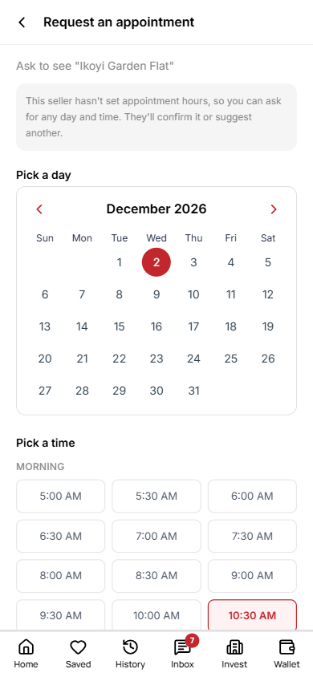

# Buying and renting

## The steps

1. **Find it.** Search homes by location, budget and type, from studio flats to land.
2. **Secure it.** Choose **Buy now** or **Rent now** at the listed price, or **Make an offer** if the seller accepts offers. Your money is locked in escrow, a smart contract. It does not go to the seller.
3. **Wait for the seller.** The seller accepts or rejects. If they reject, or accept someone else, your money comes straight back.
4. **Book appointment.** Once accepted, ask for a time to inspect the property, within the seller's days and hours (or any time, if they haven't set any). The seller approves it, or suggests another time you can book with one tap.
5. **Read the agreement.** After the inspection the seller sends the agreement and documents. Read them in the app.
6. **Accept, ask for changes, or cancel.** Accept and the deal is agreed; the payment is released to the seller after a 24-hour hold. Or ask the seller to change the agreement, or reject it and cancel for a full refund.

<figure><figcaption>
Ask for a time; the seller approves it or suggests another
</figcaption></figure>

Your deals are under **History**, with the step you're on and who needs to act next. Chat with the seller from the deal at any point.

## Cancelling and refunds

* **Before the seller accepts**: cancel at any time and get all your money back. An offer that isn't accepted within 7 days expires; reclaim your money from the deal in History.
* **After the seller accepts**: until the agreement is sent, you can still cancel for a full refund.
* **When the agreement arrives**: you can reject it and cancel for a full refund.
* **Once you accept the agreement**: the deal can't be cancelled. If something is wrong before the payment is released, raise a dispute from the deal.

Refunds are free. Nothing is taken from money returned to you.

## Renting and your damage deposit

A rental is paid as the rent plus, if the landlord asks for one, a refundable damage deposit. Both are shown on the listing, and both go into escrow when you choose Rent now.

* The damage deposit is held against damage during your lease. It isn't rent and it isn't paid to the landlord; it stays in escrow for the whole lease.
* What counts as damage is what you and the landlord agreed in the rent agreement. Normal wear from living there is not damage.
* When the lease ends, the landlord has 7 days to claim against it. If they don't, the whole deposit is yours to take back.
* You can ask to renew before the lease ends; the landlord accepts the renewal in the app.


**Always pay through Sheda Solutions.** Escrow only protects money paid in the app. Never pay a seller or agent directly, by bank transfer or in cash.

