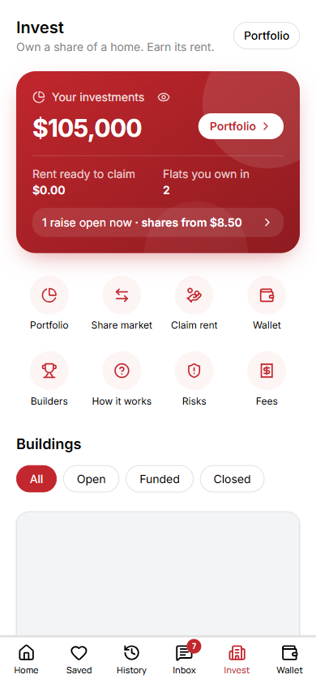

# Sheda Collections

Sheda Collections is fractional ownership on Sheda Solutions. Builders raise from many investors to build or buy, and each investor owns shares in one specific flat. The rent that flat earns is shared between its owners, in proportion to their shares.

What separates it from property crowdfunding is control: owners don't send money and hope. They choose the manager, approve each phase, see every rent payment, claim their income themselves and can exit on the share market.

<figure><figcaption>
Shares, votes and rent in one place
</figcaption></figure>

## How a raise runs

1. **The builder opens a raise** for a building: its flats, a target, a minimum investment, a deadline and a schedule of building phases. A raise can't open without a **project pack**: the builder's documents of title, approvals, costs, timeline and agreements. Its fingerprint is recorded on the blockchain, so it can't be swapped later.
2. **Investors choose a flat and an amount**, and vote for the property manager they want. Their money waits in the raise contract, not with the builder.
3. **While the round fills**, investors can take their money back out, except in its last 7 days or once it's full.
4. **If the round misses its deadline**, everyone gets all their money back.
5. **When it fills**, the manager with the most votes (weighted by money) is chosen, and building begins.

## Investors have a say

* **Choose the manager.** Owners vote for the property manager who runs the building. Owners of more than half a flat's shares can replace the manager later.
* **Approve every phase.** The builder is paid one phase at a time. The manager inspects each phase in person and signs it off, then owners have 7 days to object. If a quarter of the money in the raise objects, the payment is held and the build stops.
* **See every payment.** Each flat's rent lands in its own vault on the blockchain, visible to every owner.
* **Claim income directly.** Owners claim their share of the rent themselves, whenever it's ready.
* **Exit on their terms.** Sell shares, or buy more, on the open share market.

If the builder's own company is also the manager, it would be signing off its own work. So each payment then needs approval from more than half of the money in the raise.

## Builders have stake

Builders put stake, their own money, behind their profile in a stake registry on the blockchain. Investors see how much cover each raise carries before they commit. If a build stops, investors take back what hasn't been paid to the builder yet, plus their share of the cover set aside from the builder's stake.

The same stake can't stand behind two raises at once, so the cover a raise shows is always real.

## Builders are ranked on their record

Every builder and manager profile shows the record behind its rank: jobs finished on time, late or abandoned, the stake they've posted, and anything ever taken from it. The rank is worked out from those facts in the open, so anyone can check it. A rank needs at least 2 finished projects; until then a profile reads "Not rated yet".

## From building to rent

When the building is finished, it's handed to the chosen manager, who lets the flats through the marketplace like any other listing. Each flat's rent goes into its vault, where it's split:

* the manager's fee (shown on their profile),
* 5% kept in a repair reserve for the flat,
* 2% to Sheda Solutions,
* and the rest to the flat's owners, in proportion to their shares.

Owners follow each flat's life in the app: funding, building, with the manager, listed, rented.


Any return shown on a raise is the builder's own estimate, not a promise. Read [Risks of investing](../guides/investing.md#risks-of-investing) before you invest.

