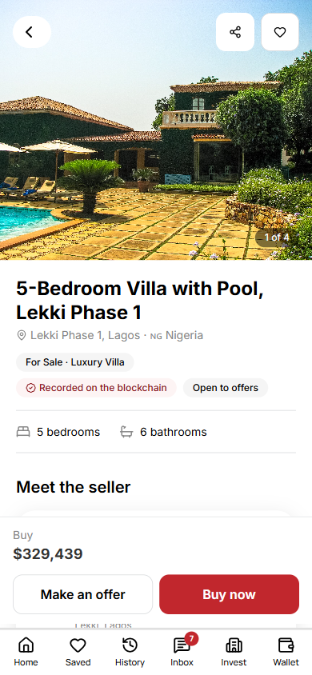

# The marketplace

The marketplace is where homes and land are rented, bought and sold directly between people.

## How a deal works

Every deal follows the same order, so both sides always know what comes next and where the money is.

1. **Secure it.** The buyer or renter chooses **Buy now** or **Rent now** at the listed price, or **Make an offer** if the seller accepts offers. Their money goes into escrow, a smart contract. It does not go to the seller.
2. **The seller decides.** The seller accepts the offer they want. Every other offer's money goes straight back to its buyer.
3. **Book appointment.** The buyer asks for a time to inspect the property, within the seller's appointment days and hours. The seller approves it, or declines with a note and a suggested time.
4. **Agreement.** After the inspection, the seller sends the agreement and documents. The buyer reads them in the app, and can accept, ask for changes, or reject and cancel for a full refund.
5. **Payment.** Once the buyer accepts the agreement, the payment is released to the seller after a 24-hour hold.

<figure><figcaption>
Every listing starts with Buy now, Rent now or Make an offer
</figcaption></figure>

## What makes it different

* **Money in escrow before anyone meets.** Sellers only spend time on buyers whose money is already committed; buyers never pay a person directly.
* **Ownership on record.** Each listed property is recorded on the blockchain as its owner's, so a home can't quietly be sold twice.
* **Appointments on request.** Sellers set the days and hours they take appointments. Several buyers can ask for the same time; nothing is booked until the seller approves it.
* **Refundable damage deposits.** For rentals, the damage deposit stays in escrow for the whole lease, not with the landlord, and comes back to the renter if there's no damage.
* **Documents always to hand.** Agreements and documents, with several pages or images each, are kept with the deal and open on any device.
* **Chat per property.** Buyers and sellers talk in one conversation per property. People with a business profile can reply as themselves or as their business.
* **Prices in 24 currencies**, including naira, so everyone sees a price they understand.
